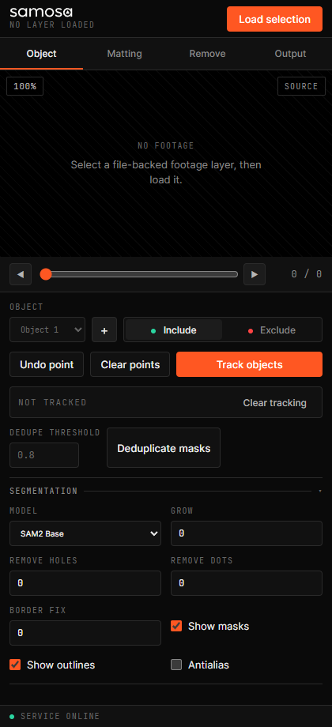

# Samosa

[](https://github.com/tenetmotion/Samosa/actions/workflows/ci.yml)
[](LICENSE)
[](docs/INSTALL.md)

Samosa is an open-source, dockable rotoscoping panel for Adobe After Effects. It connects After Effects to a local [Sammie-Roto-2](https://github.com/Zarxrax/Sammie-Roto-2) runtime, with optional isolated [SAM 3.1](https://github.com/facebookresearch/sam3) and [CorridorKey 2.0](https://github.com/nikopueringer/CorridorKey2.0) support, so object selection, tracking, matting, removal, export, and import stay inside the After Effects workflow.

Samosa is an independent integration project. It is not an official Sammie-Roto-2 project and is not affiliated with or endorsed by Adobe.



**Documentation:** [Windows installation](docs/INSTALL.md) | [macOS installation](docs/INSTALL_MACOS.md) | [Model installation](docs/MODELS.md) | [After Effects tutorial](docs/AFTER_EFFECTS_TUTORIAL.md) | [Development](docs/DEVELOPMENT.md) | [Third-party licenses](THIRD_PARTY_NOTICES.md)

## Status

The current release targets Windows and macOS with After Effects 2021 or newer through CEP. The selector is embedded in the docked panel. A future native Custom Comp UI module can route clicks from the Composition viewer to the same local service API.

## Features

- Multiple objects with include and exclude point prompts
- SAM 2.1 selection and clip-wide object tracking on Windows and macOS
- Optional SAM 3.1 point, box, text, and positive/negative example prompts on Windows NVIDIA
- MatAnyone, MatAnyone2, and VideoMaMa matting adapters
- Optional CorridorKey 2.0 green/blue-screen matting with tracked-mask, first-frame, or automatic hints and scene-linear EXR cutouts on Windows NVIDIA
- MiniMax and OpenCV removal adapters
- Mask cleanup, growth, antialiasing, and duplicate-frame controls
- PNG, EXR, and video output with automatic import into the active composition
- Background jobs with progress, cancellation, and tracked-frame state
- 100%, 75%, and 50% viewer scaling

## Requirements

- Windows 10/11, or macOS 13 or newer
- Adobe After Effects 2021 or newer
- Internet access during runtime and model installation
- Windows: a supported NVIDIA, Intel, or CPU backend
- macOS: Apple Silicon MPS acceleration or Intel CPU processing
- SAM 3.1: Windows, an NVIDIA CUDA backend, accepted gated model access, and a Hugging Face read token
- CorridorKey 2.0: Windows, an NVIDIA CUDA backend, substantial additional disk space, and acceptance of the separate Corridor Key Licence

Samosa installers do not embed model weights or Adobe SDK files. They download a pinned Sammie-Roto-2 source revision, Python runtime, and selected checkpoints during installation or first use.

## Install

Download the installer for your platform from the [latest release](https://github.com/tenetmotion/Samosa/releases/latest):

- Windows: `Samosa-Setup-1.4.0.exe`
- macOS: `Samosa-1.4.0-macOS.pkg`

Both installers create a local runtime and configure the After Effects CEP panel. See [Windows installation](docs/INSTALL.md) or [macOS installation](docs/INSTALL_MACOS.md).

Choose one model mode:

- **Standard:** installs SAM2 Base now; missing Sammie model packs download when first requested.
- **Complete:** pre-downloads every supported Sammie model after its license notices are accepted and can prepare SAM 3.1 on Windows NVIDIA.
- **Custom:** selects individual model packs and can opt into SAM 3.1 on Windows NVIDIA.

SAM 3.1 weights are gated and are never bundled by Samosa. After receiving access, select **SAM 3.1** in the panel, acknowledge the Meta SAM License, enter a Hugging Face read token, and choose **Install**. The token is passed only to the setup child process and is not written to configuration, state, or logs.

CorridorKey 2.0 is also never bundled. Select it under **Matting**, review and accept its separate license, then choose **Install CorridorKey**. Samosa downloads pinned upstream source, weights, and foundation models into an isolated runtime. CorridorKey's license restricts commercial use and paid inference; obtain written permission from Corridor before using this integration commercially.

Restart After Effects and open **Window > Extensions (Legacy) > Samosa**.

See [Model installation](docs/MODELS.md) for exactly what happens when Standard mode encounters a missing model.

## Quick tutorial

1. Open a composition and select exactly one file-backed footage layer.
2. Open **Window > Extensions (Legacy) > Samosa**, then choose **Load selection**.
3. With SAM 2.1, click the viewer to add Include points; right-click or switch to Exclude to remove areas. With SAM 3.1, choose Point, Box, Text, or Example prompting. Add another object when needed.
4. Choose **Track objects**. Add correction points on problem frames and track again.
5. Use **Matting** for refined alpha edges or **Remove** to fill the selected area.
6. Under **Output**, choose the output description, object, format, and destination, then select **Export and add to comp**.

Exports use readable names such as `interview_Hero_Person_matting_matte`. See the [After Effects tutorial](docs/AFTER_EFFECTS_TUTORIAL.md) for the complete workflow.

## Development

Run the source-only contract suite with any Python 3.10+ interpreter:

```powershell
python -m unittest discover -s tests -v
node tests/test_panel_runtime.js
node tests/test_sam3_panel_runtime.js
```

Set `SAMMIE_REPO` and run with the upstream virtual environment to include the deterministic integration suite:

```powershell
$env:SAMMIE_REPO = "D:\path\to\Sammie-Roto-2"
& "$env:SAMMIE_REPO\.venv\Scripts\python.exe" -m unittest discover -s tests -v
```

See [Development](docs/DEVELOPMENT.md), [Architecture](docs/ARCHITECTURE.md), and [Releasing](docs/RELEASING.md).

## Licensing and model restrictions

Samosa source code is licensed under GPL-3.0. It directly integrates with the GPL-3.0 Sammie-Roto-2 runtime, so GPL-3.0 is the conservative and compatible release choice.

Some optional engines exposed through Sammie-Roto-2 have separate noncommercial terms. In particular, MatAnyone uses the S-Lab noncommercial license, MiniMax Remover uses CC BY-NC 4.0, and VideoMaMa code uses CC BY-NC 4.0 while its model dependencies have separate Stability AI terms. SAM 3.1 source and weights use the separate Meta SAM License and gated model terms. CorridorKey 2.0 uses the separate Corridor Key Licence and requires written permission for commercial use. Installing or downloading any component does not grant rights beyond its own license. Review [Third-Party Notices](THIRD_PARTY_NOTICES.md) before distributing Samosa or using optional engines commercially.

## Upstream relationship

Samosa is maintained as a separate repository because it is an After Effects integration and does not modify Sammie-Roto-2 core. Fork Sammie-Roto-2 only if a contribution requires maintaining upstream core patches; submit generally useful changes upstream when possible. See [Notice](NOTICE.md) for the exact provenance used during development.

## Acknowledgements and connected projects

Samosa exists because of the work in [Sammie-Roto-2](https://github.com/Zarxrax/Sammie-Roto-2) by Zarxrax and contributors. The workflows it exposes connect to [SAM 2](https://github.com/facebookresearch/sam2), [SAM 3](https://github.com/facebookresearch/sam3), [EfficientTAM](https://github.com/yformer/EfficientTAM), [MatAnyone](https://github.com/pq-yang/MatAnyone), [MatAnyone2](https://github.com/pq-yang/MatAnyone2), [VideoMaMa](https://github.com/cvlab-kaist/VideoMaMa), [MiniMax Remover](https://github.com/zibojia/MiniMax-Remover), and [CorridorKey 2.0](https://github.com/nikopueringer/CorridorKey2.0) by Niko Pueringer and Corridor Digital. Attribution here does not replace each project's license or model terms; see [Third-party notices](THIRD_PARTY_NOTICES.md).

## Contributing

Contributions are welcome under GPL-3.0. Read [Contributing](CONTRIBUTING.md), [Security](SECURITY.md), and the [Code of Conduct](CODE_OF_CONDUCT.md) before opening a change.
